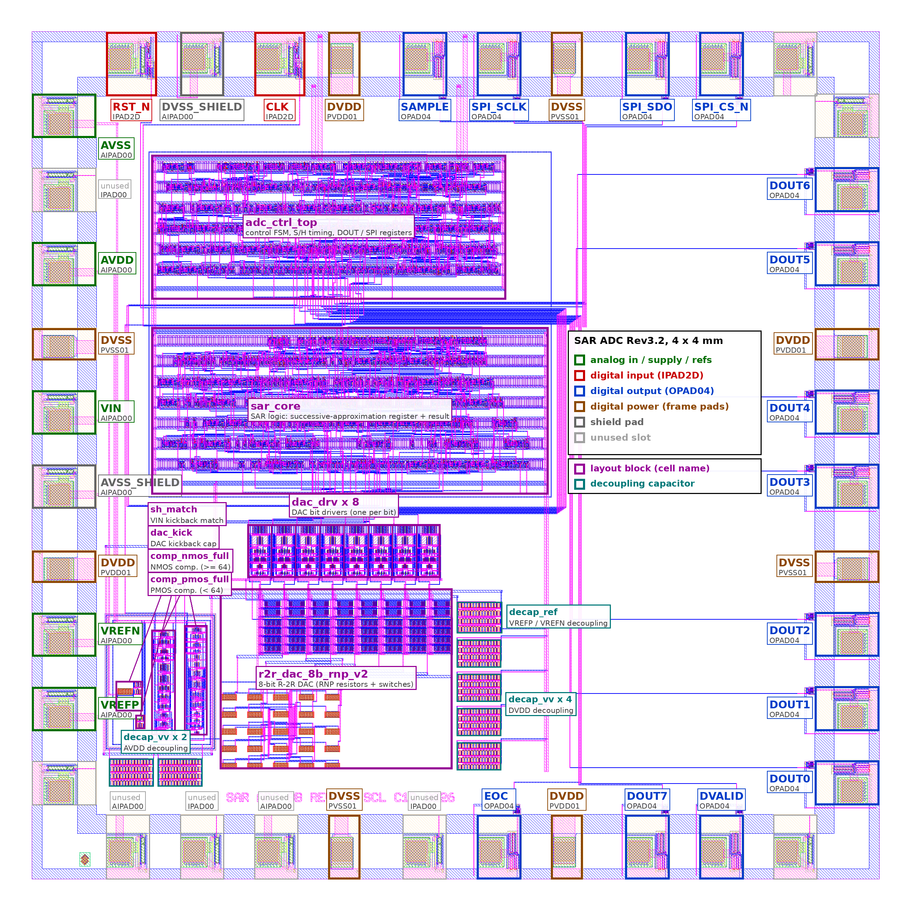

# Swar: offline voice AI on a home-grown ADC chip

An offline voice-command system built around our own **8-bit SAR ADC**, designed for India's **SCL 1.2 µm CMOS**
process. The chip digitises the microphone, an FPGA oversamples and filters the signal into clean 16 kHz audio, and a
tiny neural network on an ESP32-S3 recognises spoken keywords on the device. No cloud, no imported audio codec.

> **Status:** the ADC is designed and verified at post-layout level (layout DRC/LVS clean, extracted-parasitic
> transistor-level simulation). All voice and keyword results below are **simulations** that use the post-layout
> chip model. Silicon is not fabricated yet.

**Pitch deck:** https://angelgarg.github.io/swar-voice-adc/



## How it works

```
mic + preamp ─▶ external S/H ─▶ [ our 8-bit SAR ADC, 2 MS/s ] ─▶ Basys3 FPGA ─────────────▶ ESP32-S3
                                  SCL 1.2 µm, 4 x 4 mm die        CIC /25 + FIR /5             log-mel + CNN
                                                                  -> 16 kHz, ~10-bit audio     (21.7k parameters)
                                                                  UART 917 kbaud               -> keyword
```

1. **ADC (the ear):** 8-bit SAR with an R-2R DAC and dual StrongARM comparators. It runs 125× faster than the
   16 kHz audio rate.
2. **FPGA (the filter):** a 4th-order CIC plus a 127-tap FIR decimate 2 MS/s to 16 kS/s. Oversampling gives the
   8-bit converter about **10 bits** of quality in the voice band.
3. **ESP32-S3 (the brain):** turns the audio into a 40-band log-mel spectrogram, and a small CNN classifies
   10 keywords: *yes, no, up, down, left, right, on, off, stop, go*.

## Results (simulation, post-layout ADC model)

**Voice band, 50 Hz – 7 kHz** (1 kHz tone, −1 dBFS, nominal corner, `results/VOICE_MODEL_*.txt`)

| Converter | SNDR | ENOB |
|---|---|---|
| Our ADC alone, 8-bit at 2 MS/s | 46 dB | 7.4 bit |
| **Our ADC + FPGA oversampling, 16 kS/s output** | **59.5–61.7 dB** | **9.6–10.0 bit** |

The FPGA testbench (`fpga/tb_voice.v`, Icarus Verilog) gives 60.4 dB, the same as the Python reference model.

**Keyword spotting, 10 keywords, 1000 test clips** (`results/KWS_EVAL.txt`)

| Input | Normal speech (−6 dBFS) | Quiet speech (−26 dBFS) |
|---|---|---|
| 16-bit microphone reference | 93.4 % | 88.5 % |
| Plain 8-bit converter at 16 kS/s | 91.6 % | 66.6 % |
| **Our ADC + oversampling (TT / SS / FF corners)** | **90.2–90.5 %** | **81.8–83.1 %** |

On quiet speech, oversampling recovers most of what a plain 8-bit converter loses (83 % instead of 67 %).

**The chip** (`results/ADC_SUMMARY_TABLE.md`, `docs/ADC_VTC_DNL_INL.png`): 8-bit, 5 V, input range 4.0 V
(LSB 15.6 mV), ENOB 7.8–7.9 bit, DNL ≤ 0.27 LSB, INL ≤ 0.55 LSB, no missing codes, 13.9 mW at 400 kS/s,
4 × 4 mm die.

## Repository

| Path | Contents |
|---|---|
| `fpga/` | `voice_top.v` (ADC interface, CIC, FIR, UART), `tb_voice.v`, Basys3 constraints, FIR coefficients, test vectors |
| `model/voice_model.py` | ADC + decimation model: voice-band SNDR / ENOB, and the FIR coefficients |
| `model/kws_eval.py` | trains the keyword CNN, then evaluates it through the ADC model; `kws_cnn.pt` = trained weights |
| `data/adc_transfer/` | post-layout ADC transfer data (DAC level of every code, extracted netlist), TT / SS / FF |
| `results/` | voice, keyword and chip summary results |
| `docs/` | pitch deck web page (`index.html`, GitHub Pages), chip layout image, transfer curve / DNL / INL plots |

## Run it

```bash
pip install -r requirements.txt
cd model && python3 voice_model.py --corner NOM          # voice-band SNDR / ENOB
python3 kws_eval.py <path to Google Speech Commands v0.02>  # keyword spotting (trains the CNN, then evaluates)
cd ../fpga && iverilog -g2012 -o tb.vvp tb_voice.v voice_top.v && vvp -n tb.vvp   # FPGA testbench, 40 ms simulated
# (the FPGA holds the ADC in reset for the first ~10 ms; -DTSIM=<ns> sets a shorter or longer run)
```

## Notes

- The voice results assume a 50 MHz ADC clock (2 MS/s). At 10 MHz (400 kS/s) the oversampling ratio drops from
  125 to 25, so the voice-band gain is smaller.
- The microphone, preamp and sample-and-hold are external parts on the board. The model includes a −66 dBFS
  microphone noise floor.
